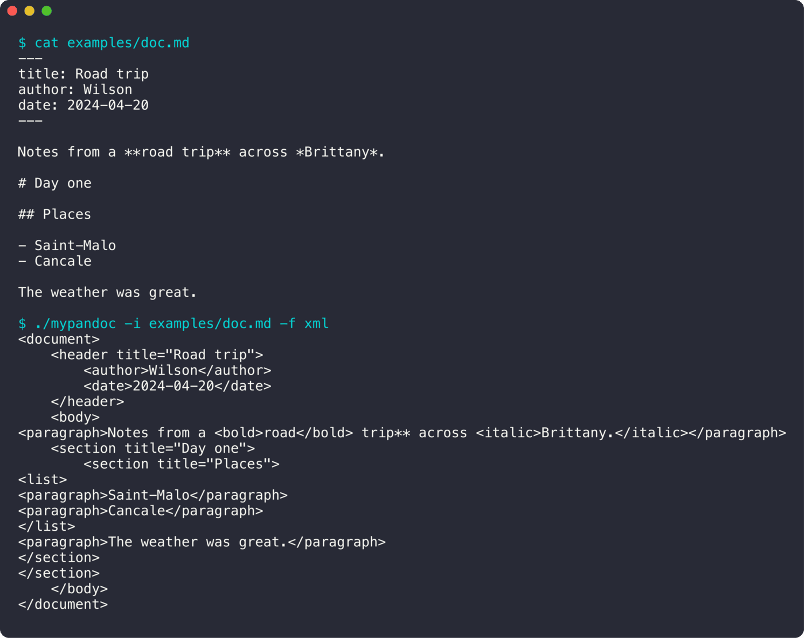

<div align="center">

# MyPandoc

**Un convertisseur de documents en Haskell, avec sa propre bibliothèque de parsing.**

 

<sub>Projet à 4 · 2024</sub>

</div>

<br/>

<p align="center"></p>

## Le projet en quelques mots

Une version simplifiée de *pandoc* : on lit un document en Markdown, XML ou JSON, et on le réécrit dans un autre format. Sans Parsec, le parsing repose sur nos propres combinateurs.

## Ce que ça fait

- Bibliothèque de **parser combinators** écrite à la main
- Représentation commune : en-tête, sections, paragraphes, listes, gras, italique, code
- Conversions Markdown → XML et Markdown → JSON
- Choix du format de sortie (`-f`) et du fichier de sortie (`-o`)

## Lancer le projet

```bash
make
./mypandoc -i examples/doc.md -f xml
./mypandoc -i examples/doc.md -f json
```

## L'équipe

<a href="https://github.com/Wilson-Epitech/mypandoc/graphs/contributors"></a>

Edward Lalande, Timothée Plisson, Paul Bardeur, Wilson Bordichon

**Ma partition :** J'ai écrit la conversion **Markdown → XML** : en-tête, sections, paragraphes, gras, italique, code, blocs de code et listes.
